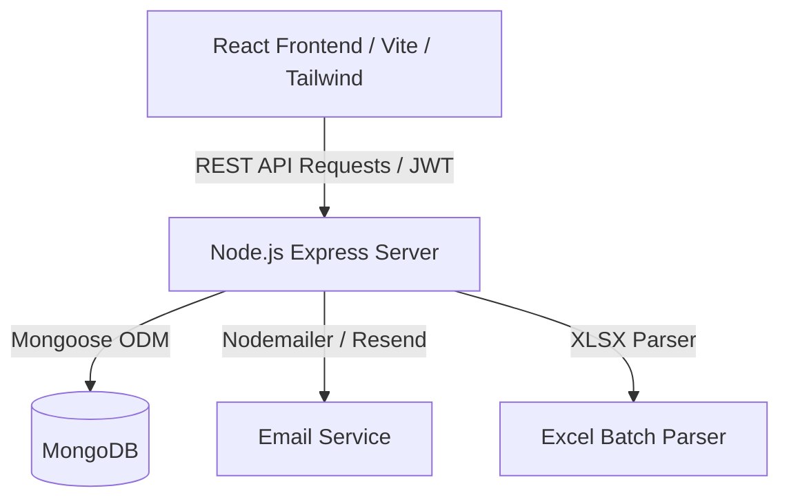

# 💎 LabMadeDiamond - B2B Diamond Inventory & Quotation Platform

[](https://react.dev/)
[](https://tailwindcss.com/)
[](https://nodejs.org/)
[](https://www.mongodb.com/)
[](https://www.docker.com/)

A modern, full-stack B2B marketplace and inventory management web application built for lab-grown diamond wholesalers, manufacturers, and buyers. It features an interactive diamond catalog with advanced filtering, cart and quotation request flows, user registration approval workflows, and an administrative back-office for batch inventory uploads (Excel/XLSX), quote management, and analytics.

---

## ✨ Features

### 👤 Buyer & Client Portal
- **Interactive Diamond Catalog:**
  - Real-time filtering by Shape, Carat range, Color (D-Z), Clarity (FL to I3), Cut, Polish, Symmetry, Fluorescence, Lab Certificate (IGI, GIA, HRD), and Price.
  - High-performance data table powered by AG Grid with sorting and multi-column filtering.
  - Detailed diamond view with certificate links, cut parameters, and dimensions.
- **Quotation Cart System:**
  - Add single or multiple diamond stones to quotation cart.
  - Submit formal inquiry / quotation requests directly to sales administrators.
  - Track quote statuses (`Pending`, `Under Review`, `Approved`, `Rejected`) under **My Requests**.
- **Customer Authentication & Onboarding:**
  - Secure registration with OTP email verification.
  - B2B business approval gate (accounts require admin approval prior to catalog trade access).
  - Forgot password / reset flow with secure verification codes.
- **Responsive Design:**
  - Seamless desktop, tablet, and mobile user experience.

### 🛡️ Admin Dashboard & Operations
- **Overview & Metrics:** Key statistics including active users, pending user approvals, total catalog stones, and incoming quote requests.
- **Batch Inventory Management:**
  - Upload diamond stock via Excel spreadsheets (`.xlsx`, `.xls`, `.csv`).
  - Automated parsing, field mapping, and database synchronization.
  - Inspect historical upload batches and status logs.
- **User Account Management:**
  - Approve or decline new business registrations.
  - Manage user access status and roles.
- **Quote & Inquiry Management:**
  - Review diamond inquiries submitted by clients.
  - Update quotation status, record internal notes, and notify clients.

---

## 🏗️ Architecture & Tech Stack



| Layer | Technologies |
|---|---|
| **Frontend** | React 19, Vite, Tailwind CSS v4, AG Grid Community, React Router v7, React Icons, Axios |
| **Backend** | Node.js, Express 5, Mongoose 9, JWT, BcryptJS, Multer, XLSX, Express Rate Limiter, Helmet |
| **Database** | MongoDB |
| **DevOps & Tooling** | Docker, Docker Compose, Concurrently |

---

## 📁 Repository Structure

```plaintext
LabMadeDiamond/
├── backend/
│   ├── src/
│   │   ├── config/          # DB connection & mailer configurations
│   │   ├── controllers/     # Admin, Auth, Inventory, OTP, Quote controllers
│   │   ├── middleware/      # JWT authentication, rate limiting, multer upload
│   │   ├── models/          # Mongoose data schemas (User, Admin, Inventory, Quote)
│   │   ├── routes/          # Express route definitions
│   │   ├── utils/           # Token generation & utility helpers
│   │   ├── app.js           # Express app setup and middleware stack
│   │   └── server.js        # Server bootstrap & MongoDB connection
│   ├── createAdmin.js       # Admin account seeding script
│   ├── Dockerfile
│   └── package.json
├── frontend/
│   ├── src/
│   │   ├── assets/          # Images, logos, and svg vectors
│   │   ├── components/      # Navbar, Footer, Inventory Filters, Admin widgets
│   │   ├── context/         # AuthContext & QuoteCartContext providers
│   │   ├── layouts/         # MainLayout and Home layouts
│   │   ├── pages/           # Client views & Admin portal views
│   │   ├── routes/          # App routing with route protection guards
│   │   ├── services/        # Axios API clients for backend endpoints
│   │   ├── App.jsx
│   │   └── main.jsx
│   ├── Dockerfile
│   └── package.json
├── docker-compose.yml       # Multi-container orchestration (Frontend, Backend, Mongo)
├── .env.example             # Template for environment configuration
└── package.json             # Root scripts to run both client and server
```

---

## 🚀 Getting Started

### Prerequisites
- [Node.js](https://nodejs.org/) (v18 or higher)
- [MongoDB](https://www.mongodb.com/) (local instance or MongoDB Atlas URI)
- [Docker & Docker Compose](https://www.docker.com/) *(optional, for containerized run)*

---

### Local Development Setup

#### 1. Clone the Repository
```bash
git clone https://github.com/Smit0007/LabMadeDiamond.git
cd LabMadeDiamond
```

#### 2. Configure Environment Variables
Create a `.env` file in the root directory (or copy `.env.example`):
```bash
cp .env.example .env
```

Configure your variables:
```env
PORT=5000
BACKEND_PORT=5000
FRONTEND_PORT=5173
MONGODB_URI=mongodb://localhost:27017/Diamond
JWT_SECRET=your_jwt_secret_key_here
CLIENT_URL=http://localhost:5173

# Email verification (Gmail App Password or SMTP)
EMAIL_USER=your_email@gmail.com
EMAIL_PASS=your_email_app_password
```

#### 3. Install Dependencies
Install dependencies for root, backend, and frontend:
```bash
npm install
cd backend && npm install
cd ../frontend && npm install
cd ..
```

#### 4. Seed Initial Admin Account
Run the admin creation script to generate the default administrator:
```bash
node backend/createAdmin.js
```

#### 5. Start Development Server
Run both frontend and backend concurrently using the root script:
```bash
npm run dev
```

- **Frontend Client:** [http://localhost:5173](http://localhost:5173)
- **Backend API:** [http://localhost:5000](http://localhost:5000)

---

### Running with Docker Compose

To spin up the entire stack including MongoDB in containers:

```bash
docker-compose up --build
```

---

## 🔒 Security Best Practices
- Passwords salted and hashed with `bcryptjs`.
- Stateless authorization powered by `jsonwebtoken` (JWT).
- HTTP headers hardened with `helmet`.
- Request rate limiting via `express-rate-limit` against brute-force attacks.
- Sensitive environment variables excluded from source control via `.gitignore`.

---

## 📄 License
This project is open-source and available under the [ISC License](LICENSE).

